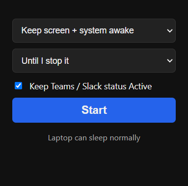
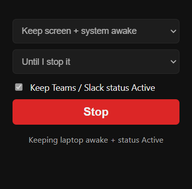

# Stay Awake

A tiny Windows desktop app (Electron) that keeps your laptop awake and stops Microsoft Teams / Slack from flipping you to **Away**.

Handy for long downloads, builds, presentations, or leaving an AI coding agent running in VS Code all day.

| Idle | Running |
| --- | --- |
|  |  |

## Features

- **Keep screen + system awake**: the display stays on and the laptop never sleeps.
- **Keep system awake only**: the display can turn off, but the laptop keeps running (uses less power).
- **Keep Teams / Slack status Active**: stops your status from going Away while you're not at the keyboard.
- **Timer**: run until you stop it, or for 30 min, 1 hour or 2 hours.
- Click **Stop** or close the window and your normal power settings come back.

## How it works

| Feature | Mechanism |
| --- | --- |
| Keep awake | Electron's [`powerSaveBlocker`](https://www.electronjs.org/docs/latest/api/power-save-blocker), which calls the Windows `SetThreadExecutionState` API, the same request video players use. |
| Teams / Slack Active | Teams and Slack mark you Away after about 5 minutes without keyboard or mouse input. A hidden PowerShell loop presses **F15** every 60 seconds. F15 counts as real input but no app reacts to it, so nothing gets typed. |

To check it's working, run this in an Administrator terminal while the app is running:

```powershell
powercfg /requests
```

`electron.exe` should be listed under `DISPLAY` and `SYSTEM`.

## Getting started

Requirements: Windows 10/11 and [Node.js](https://nodejs.org/) 18+.

```bash
git clone https://github.com/<your-username>/stay-awake.git
cd stay-awake
npm install
npm start
```

After `npm install` you can also just double-click **`StayAwake.bat`**.

> Running from the VS Code terminal? VS Code sets `ELECTRON_RUN_AS_NODE=1`, which stops Electron windows from opening. `npm start` and `StayAwake.bat` clear it for you.

## Limitations

- It can't stop sleep when you **close the lid**. To allow that, set *Control Panel → Power Options → Choose what closing the lid does → When plugged in: Do nothing*.
- Choosing Sleep yourself, pressing the power button, a critical battery or a Windows Update restart still take effect.
- Your workplace may have rules about presence status. Check them before using the Teams feature.

## Project structure

```
main.js              Electron main process: power blocker + presence loop
preload.js           Safe bridge between the UI and the main process
index.html           The UI
StayAwake.bat        Double-click launcher
scripts/screenshot.js  Regenerates docs/*.png (npm run screenshots)
docs/                README screenshots
```

## Contributing

### Branching strategy

| Branch | Purpose |
| --- | --- |
| `main` | Stable, released code. Only changes merged from `develop` land here. |
| `develop` | Day-to-day work. All commits go here first. |

All work is committed on `develop`, then merged into `main` with a merge commit (`git merge --no-ff develop`) once it's working.

### Commit messages

This repo follows [Conventional Commits](https://www.conventionalcommits.org/):

```
<type>(<optional scope>): <short summary in imperative mood>
```

| Type | Use for |
| --- | --- |
| `feat` | A new feature |
| `fix` | A bug fix |
| `docs` | README / documentation only |
| `refactor` | Code change that neither fixes a bug nor adds a feature |
| `chore` | Tooling, dependencies, config |

Examples: `feat: keep teams status active`, `fix(timer): stop presence loop when timer ends`.

## License

[MIT](LICENSE)
